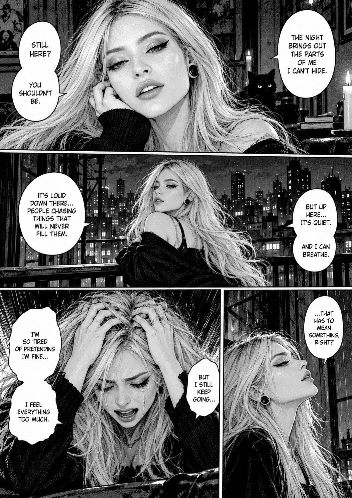

# Creative Studio

An archive of original AI-assisted creative projects: music compositions and illustrated manga.

## Projects

### Iron Fugue — Symphonic Metalcore

An instrumental sketch blending classical contrapuntal lines with metalcore rhythm, distorted guitars, and a halftime breakdown.

- **Key:** D minor
- **Tempo:** 160 BPM
- **Length:** ~57 seconds
- **Listen:** [MP3](music/Iron_Fugue/Iron_Fugue_Symphonic_Metalcore.mp3)
- **Edit the arrangement:** [MIDI](music/Iron_Fugue/Iron_Fugue_Symphonic_Metalcore.mid)
- **Uncompressed audio:** [WAV](music/Iron_Fugue/Iron_Fugue_Symphonic_Metalcore.wav)
- **Original synthesis script:** [Python source](music/Iron_Fugue/source/compose_symphonic_metalcore.py)

The provided audio is a synthesized demo, not a studio performance. The original Python rendering script was written for a Linux environment with libfluidsynth, a TimGM6mb soundfont installed at `/usr/share/sounds/sf2/TimGM6mb.sf2`, and Python packages NumPy, SciPy, SoundFile and Mido. It writes its WAV and MIDI outputs to `/mnt/data`; you may need to adjust paths and install those dependencies before re-running it. MP3 conversion from WAV is a separate step.

### Midnight Reflections — Manga

A monochrome, dramatic manga page featuring a blonde protagonist in a nighttime urban setting, created using a reference image supplied for the request.



- **Artwork:** [PNG](manga/Midnight_Reflections/Midnight_Reflections_Page_01.png)

## Repository layout

```text
music/
  Iron_Fugue/
    Iron_Fugue_Symphonic_Metalcore.mp3
    Iron_Fugue_Symphonic_Metalcore.mid
    Iron_Fugue_Symphonic_Metalcore.wav
    source/compose_symphonic_metalcore.py
manga/
  Midnight_Reflections/
    Midnight_Reflections_Page_01.png
README.md
PROVENANCE.md
.gitignore
```

## Notes

- The original screenshot used as visual reference is **not included**, to avoid redistributing an unrelated creator's livestream screenshot.
- The manga is AI-generated artwork; it is not an official work of any existing manga franchise.
- No open-source/content reuse license has been selected for this collection.